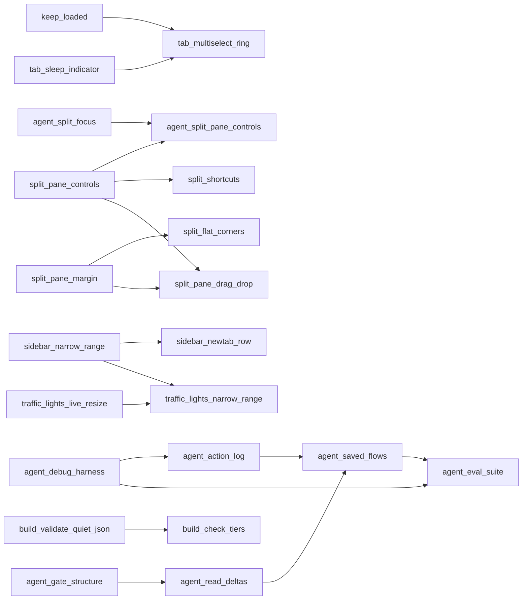

# Upstream series

Everything in fork `develop` that `Alexays/Lilo` main lacks, grouped into focused pull requests. Written on 2026-11-21 against `upstream/main` c0cb8cb9 and `origin/develop` 1febf836 (merge base 6590305b, 283 commits ahead, 46 behind, 74 merged fork PRs). The machine-readable copy is [upstream-series.json](upstream-series.json). Every upstream change needs an issue and a pull request pair, filed under the fork owner.

## What upstream already has

Merged upstream from the fork: #34 (Cmd-W closes the system screen), #36 (rail animation), #39 (divider color), #40 (multi-tab selection), #48 (Debug click mode), #61 (tab-scoped consent), #65 (browser pickers), #67 (deferred settings catalog), #69 (i18n lint), #72 (typed consent answers), #80 (catalog readers test), #89 (ICU catalogs), #111 (Downloads directory for the GIF). Nothing to do for these.

## Dropped (fork-only), with reasons

| Fork PRs | Reason |
|---|---|
| #16, #53 | Fork beta prerelease CI |
| #87, #100 | Configurable update feeds and beta tag: the fork's own release channel |
| #18, #46, #51, #56, #113 | Fork planning and design scratch (agent harness, entry design, consent decision model, first-frame metrics, agents settings note) |
| #62 | Import-from-Lilo research spike (locator plus design notes, no product surface); revisit only if upstream asks |
| #107, #112, #123, #124 | The fork's PR media workflow (`make ui-capture`, `make window-capture`, the PR media rule, capture scenarios). Upstream has no such rule; offer them separately as tooling only if wanted |

## Series

Ordered so every PR comes after the PRs it depends on, open upstream PRs and pushed branches first.

| # | Slug | Title | Fork PRs | Size (fork, incl. locales) | Visible | Captures | Status | Depends on |
|---|---|---|---|---|---|---|---|---|
| 1 | `bookmark-tiles` | fix(sidebar): shrink the favorites tiles and let them rest on the sidebar | #95 | +36/-29 | yes | yes | pr-open (#415) | none |
| 2 | `split-pane-margin` | fix(splits): keep a margin between the panes and the window frame | #99 | +204/-11 | yes | yes | pr-open (#416) | none |
| 3 | `agent-split-focus` | fix(split-panes): focus an agent pane when its conversation is clicked | #103 | +333/-1 | yes | no | pr-open (#417) | none |
| 4 | `pinned-fold-search` | feat(sidebar): search button and foldable pinned head in the divider | #105 | +317/-7 | yes | yes | pr-open (#418) | none |
| 5 | `tab-sleep-indicator` | feat(sidebar): show sleeping tabs dimmed with a dotted ring | #106 | +169/-6 | yes | yes | pr-open (#428) | none |
| 6 | `keep-loaded` | feat(tabs): Keep Loaded tab flag and site allowlist | #109 | +336/-10 | yes | yes | pr-open (#426) | none |
| 7 | `private-tab-isolation` | feat(private): per-tab ephemeral data stores in private spaces | #110 | +168/-30 | yes | no | pr-open (#424) | none |
| 8 | `screenshot-element-picker` | feat(screenshots): pick a page element by hovering in Selected Area | #108 | +193/-16 | yes | yes | pr-open (#422) | none |
| 9 | `build-bootstrap-checks` | build(setup): check the whole environment before bootstrap installs anything | #71 | +42/-9 | no | no | pr-open (#382) | none |
| 10 | `build-linux-checks` | build: add linux-checks and a Linux SwiftLint for agents on Linux | #73 | +72/-34 | no | no | pr-open (#383) | none |
| 11 | `build-pnpm-workspace` | build: move lilo-ui, site and docs-site to one pnpm workspace | none | n/a | no | no | pr-open (#384) | none |
| 12 | `agent-picker-layout` | fix(agents): keep agent picker rows from overlapping | #114 | +270/-35 | yes | yes | branch-pushed | none |
| 13 | `tab-multiselect-ring` | fix(sidebar): pinned multi-select and kept-loaded ring | #118 | +44/-20 | yes | yes | branch-pushed | `keep-loaded`, `tab-sleep-indicator` |
| 14 | `commandbar-scopes-row` | fix(commandbar): restore the scopes row and footer hints | #120 | +1216/-376 | yes | yes | branch-pushed | none |
| 15 | `split-view-fixes` | feat(splits): tell the user when the split view is full | #115 | +219/-51 | yes | yes | branch-pushed | none |
| 16 | `traffic-lights-live-resize` | fix(window): keep the traffic lights at their standard size and place through a live resize | #119 | +45/-13 | yes | no | branch-pushed | none |
| 17 | `pip-gesture-forwarding` | fix(pip): keep trackpad gestures from moving or resizing the floating panels | #121 | +87/-2 | yes | no | branch-pushed | none |
| 18 | `little-window-redesign` | feat(window): little window opens on the command bar and turns into a page window | #122 | +1395/-354 | yes | yes | branch-pushed | none |
| 19 | `hold-cmdq-to-quit` | feat(app): hold the quit shortcut to quit | #117 | +377/-1 | yes | yes | todo | none |
| 20 | `split-pane-controls` | feat(splits): per-pane close and maximize controls | #63 | +441/-4 | yes | yes | todo | none |
| 21 | `agent-split-pane-controls` | fix(splits): give agent split panes working close and maximize controls | #103, #115 | +552/-52 | yes | yes | todo | `split-pane-controls`, `agent-split-focus` |
| 22 | `split-flat-corners` | fix(splits): flat outer corners for split panes | #115 | +219/-51 | yes | yes | todo | `split-pane-margin` |
| 23 | `split-shortcuts` | fix(shortcuts): give the split view actions their keys by default | #75 | +43/-4 | yes | no | todo | `split-pane-controls` |
| 24 | `split-pane-drag-drop` | feat(split): drag a pane to swap or re-dock it, with menu moves | #116, #125 | +512/-6 | yes | yes | todo | `split-pane-controls`, `split-pane-margin` |
| 25 | `sidebar-narrow-range` | feat(sidebar): continuous narrow range to the rail's width | #88, #93 | +117/-32 | yes | yes | todo | none |
| 26 | `sidebar-newtab-row` | fix(sidebar): keep the New Tab row's buttons and step its label down | #98 | +96/-4 | yes | yes | todo | `sidebar-narrow-range` |
| 27 | `traffic-lights-narrow-range` | fix(sidebar): keep the window buttons through the sidebar's narrow range | #101 | +261/-26 | yes | yes | todo | `sidebar-narrow-range`, `traffic-lights-live-resize` |
| 28 | `agent-debug-harness` | feat(app): run the agent harness headless in Debug builds | #27, #38 | +119/-13 | no | no | todo | none |
| 29 | `agent-gate-structure` | fix(agent): decide the approval gate from the page's structure | #31 | +169/-9 | yes | no | todo | none |
| 30 | `agent-native-html5-drag` | fix(agent): run the HTML5 drag session for a native drag | #33 | +103/-7 | yes | no | todo | none |
| 31 | `agent-read-deltas` | feat(agent): viewport-scoped reads and post-action page deltas | #59 | +246/-17 | yes | no | todo | `agent-gate-structure` |
| 32 | `agent-action-log` | feat(agent): log each tool call to a local JSONL file | #55 | +405/-4 | yes | no | todo | `agent-debug-harness` |
| 33 | `agent-acp-custom-command` | feat(conversations): run a custom ACP command as an agent | #35, #45 | +436/-5 | yes | yes | todo | none |
| 34 | `agent-saved-flows` | feat(agent): saved flows - record once, replay deterministically | #77, #81, #83, #102 | +762/-19 | yes | no | todo | `agent-action-log`, `agent-read-deltas` |
| 35 | `agent-eval-suite` | test(agent): add fixture agent tasks graded in code | #29, #85 | +745/-28 | no | no | todo | `agent-debug-harness`, `agent-saved-flows` |
| 36 | `build-validate-quiet-json` | build(validate): print one line per check and JSON=1 for agents | #28 | +301/-16 | no | no | todo | none |
| 37 | `build-check-tiers` | feat(build): quick check tiers with pre-commit and pre-push hooks | #57, #79, #86, #92 | +489/-21 | no | no | todo | `build-validate-quiet-json` |
| 38 | `test-deflake` | test: widen the ACP exit wait and press Escape until the overlay shell closes | #94, #104 | +12/-4 | no | no | todo | none |

Size is the fork PR total including locales, release notes and generated files; the port is usually smaller. Slugs, titles and dependencies are also in the JSON.

## Dependency graph

## Per-PR detail

### `bookmark-tiles`

- Title: fix(sidebar): shrink the favorites tiles and let them rest on the sidebar
- Carries: fork #95; branch `upstream/bookmark-tiles`.
- Upstream: applies cleanly to upstream/main alone.
- Note: Issue #411.

### `split-pane-margin`

- Title: fix(splits): keep a margin between the panes and the window frame
- Carries: fork #99; branch `upstream/split-pane-margin`.
- Upstream: applies cleanly to upstream/main alone.
- Note: Issue #412. Introduces the margin ring. Dropped the pane-handle context (fork-only pill).

### `agent-split-focus`

- Title: fix(split-panes): focus an agent pane when its conversation is clicked
- Carries: fork #103; branch `upstream/agent-split-focus`.
- Upstream: applies cleanly to upstream/main alone.
- Note: Issue #413. Only the click-to-focus half of fork #103; the pill half moves to agent-split-pane-controls.

### `pinned-fold-search`

- Title: feat(sidebar): search button and foldable pinned head in the divider
- Carries: fork #105; branch `upstream/pinned-fold-search`.
- Upstream: applies cleanly to upstream/main alone.
- Note: Issue #414. Narrow-range commit left out (see sidebar-narrow-range).

### `tab-sleep-indicator`

- Title: feat(sidebar): show sleeping tabs dimmed with a dotted ring
- Carries: fork #106; branch `upstream/tab-sleep-indicator`.
- Upstream: applies cleanly to upstream/main alone.
- Note: Issue #427.

### `keep-loaded`

- Title: feat(tabs): Keep Loaded tab flag and site allowlist
- Carries: fork #109; branch `upstream/keep-loaded`.
- Upstream: applies cleanly to upstream/main alone.
- Note: Issue #425. Port unverified; fork KeepLoadedTests not ported.

### `private-tab-isolation`

- Title: feat(private): per-tab ephemeral data stores in private spaces
- Carries: fork #110; branch `upstream/private-tab-isolation`.
- Upstream: applies cleanly to upstream/main alone.
- Note: Issue #423.

### `screenshot-element-picker`

- Title: feat(screenshots): pick a page element by hovering in Selected Area
- Carries: fork #108; branch `upstream/screenshot-element-picker`.
- Upstream: applies cleanly to upstream/main alone.
- Note: Issue #421.

### `build-bootstrap-checks`

- Title: build(setup): check the whole environment before bootstrap installs anything
- Carries: fork #71; branch `upstream/build-bootstrap-checks`.
- Upstream: applies cleanly to upstream/main alone.
- Note: Issue #378. Fork #71 is the pinned-version part.

### `build-linux-checks`

- Title: build: add linux-checks and a Linux SwiftLint for agents on Linux
- Carries: fork #73; branch `upstream/build-linux-checks`.
- Upstream: applies cleanly to upstream/main alone.
- Note: Draft; issue #376 (discussion).

### `build-pnpm-workspace`

- Title: build: move lilo-ui, site and docs-site to one pnpm workspace
- Carries: fork integ branch (no single PR); branch `upstream/build-pnpm-workspace`.
- Upstream: applies cleanly to upstream/main alone.
- Note: Draft; issue #375 (discussion). Work done on the integ branch, no single fork PR.

### `agent-picker-layout`

- Title: fix(agents): keep agent picker rows from overlapping
- Carries: fork #114; branch `upstream/agent-picker-layout`.
- Upstream: applies cleanly to upstream/main alone.
- Note: Branch upstream/agent-picker-layout pushed to the fork.

### `tab-multiselect-ring`

- Title: fix(sidebar): pinned multi-select and kept-loaded ring
- Carries: fork #118; branch `upstream/tab-multiselect-ring`.
- Upstream: needs `keep-loaded`, `tab-sleep-indicator` first.
- Body sentence: `Depends on #426: feat(tabs): Keep Loaded tab flag and site allowlist`
- Body sentence: `Depends on #428: feat(sidebar): show sleeping tabs dimmed with a dotted ring`
- Note: Ring and indicators exist only once keep-loaded and tab-sleep-indicator land; touches TabItem and the selection store.

### `commandbar-scopes-row`

- Title: fix(commandbar): restore the scopes row and footer hints
- Carries: fork #120; branch `upstream/commandbar-scopes-row`.
- Upstream: applies cleanly to upstream/main alone.
- Note: Large (39 files incl. docs screenshots under docs/screenshots/command-bar: check they are wanted upstream).

### `split-view-fixes`

- Title: feat(splits): tell the user when the split view is full
- Carries: fork #115; branch `upstream/split-view-fixes`.
- Upstream: applies cleanly to upstream/main alone.
- Note: Issue #429. Only the full-split hint of fork #115. Corners and agent pane controls were dropped and are the two PRs below.

### `traffic-lights-live-resize`

- Title: fix(window): keep the traffic lights at their standard size and place through a live resize
- Carries: fork #119; branch `upstream/traffic-lights-live-resize`.
- Upstream: applies cleanly to upstream/main alone.
- Note: Issue #431. Tests only, no visual capture possible (live resize).

### `pip-gesture-forwarding`

- Title: fix(pip): keep trackpad gestures from moving or resizing the floating panels
- Carries: fork #121; branch `upstream/pip-gesture-forwarding`.
- Upstream: applies cleanly to upstream/main alone.
- Note: Input handling only.

### `little-window-redesign`

- Title: feat(window): little window opens on the command bar and turns into a page window
- Carries: fork #122; branch `upstream/little-window-redesign`.
- Upstream: applies cleanly to upstream/main alone.
- Note: Branch pushed. Excludes the fork-only window-capture and capture-scenario edits (AgentWindowCapture, captures/*). Largest UI PR (42 files): merge last among UI; overlaps 110, 115, 116, 120.

### `hold-cmdq-to-quit`

- Title: feat(app): hold the quit shortcut to quit
- Carries: fork #117; branch `upstream/hold-cmdq-to-quit`.
- Upstream: applies cleanly to upstream/main alone.
- Note: New HoldToQuit.swift plus a setting; run make project-sync.

### `split-pane-controls`

- Title: feat(splits): per-pane close and maximize controls
- Carries: fork #63; branch `upstream/split-pane-controls`.
- Upstream: applies cleanly to upstream/main alone.
- Note: Introduces the hover pill. Foundation for the agent pane controls, drag-drop and split shortcuts. Touches the tab bridge and state store: merge after keep-loaded and tab-sleep-indicator to avoid rebases.

### `agent-split-pane-controls`

- Title: fix(splits): give agent split panes working close and maximize controls
- Carries: fork #103, #115; branch `upstream/agent-split-pane-controls`.
- Upstream: needs `split-pane-controls`, `agent-split-focus` first.
- Body sentence: `Depends on #<split-pane-controls PR>: feat(splits): per-pane close and maximize controls`
- Body sentence: `Depends on #417: fix(split-panes): focus an agent pane when its conversation is clicked`
- Note: The pill half of fork #103 and the agent pane controls of fork #115, dropped from split-view-fixes because upstream has no hover pill.

### `split-flat-corners`

- Title: fix(splits): flat outer corners for split panes
- Carries: fork #115; branch `upstream/split-flat-corners`.
- Upstream: needs `split-pane-margin` first.
- Body sentence: `Depends on #416: fix(splits): keep a margin between the panes and the window frame`
- Note: The corner half of fork #115, dropped from split-view-fixes because upstream has no margin ring until split-pane-margin lands.

### `split-shortcuts`

- Title: fix(shortcuts): give the split view actions their keys by default
- Carries: fork #75; branch `upstream/split-shortcuts`.
- Upstream: needs `split-pane-controls` first.
- Body sentence: `Depends on #<split-pane-controls PR>: feat(splits): per-pane close and maximize controls`
- Note: Small (KeyboardShortcuts, MenuValidationTests); the actions it binds are added by split-pane-controls. Verify at port.

### `split-pane-drag-drop`

- Title: feat(split): drag a pane to swap or re-dock it, with menu moves
- Carries: fork #116, #125; branch `upstream/split-pane-drag-drop`.
- Upstream: needs `split-pane-controls`, `split-pane-margin` first.
- Body sentence: `Depends on #<split-pane-controls PR>: feat(splits): per-pane close and maximize controls`
- Body sentence: `Depends on #416: fix(splits): keep a margin between the panes and the window frame`
- Note: Also carries the demo Tab menu Move Pane items of fork #125. Overlaps split-flat-corners (3 files): merge after it.

### `sidebar-narrow-range`

- Title: feat(sidebar): continuous narrow range to the rail's width
- Carries: fork #88, #93; branch `upstream/sidebar-narrow-range`.
- Upstream: applies cleanly to upstream/main alone.
- Note: Foundation for the New Tab row and traffic lights work: upstream has min width 203 and no narrow flag. Fork #93 is its e2e fix.

### `sidebar-newtab-row`

- Title: fix(sidebar): keep the New Tab row's buttons and step its label down
- Carries: fork #98; branch `upstream/sidebar-newtab-row`.
- Upstream: needs `sidebar-narrow-range` first.
- Body sentence: `Depends on #<sidebar-narrow-range PR>: feat(sidebar): continuous narrow range to the rail's width`
- Note: Needs the narrow range.

### `traffic-lights-narrow-range`

- Title: fix(sidebar): keep the window buttons through the sidebar's narrow range
- Carries: fork #101; branch `upstream/traffic-lights-narrow-range`.
- Upstream: needs `sidebar-narrow-range`, `traffic-lights-live-resize` first.
- Body sentence: `Depends on #<sidebar-narrow-range PR>: feat(sidebar): continuous narrow range to the rail's width`
- Body sentence: `Depends on #<traffic-lights-live-resize PR>: fix(window): keep the traffic lights at their standard size and place through a live resize`
- Note: Overlaps traffic-lights-live-resize (TrafficLightAnimator): merge that one first and rebase this.

### `agent-debug-harness`

- Title: feat(app): run the agent harness headless in Debug builds
- Carries: fork #27, #38; branch `upstream/agent-debug-harness`.
- Upstream: applies cleanly to upstream/main alone.
- Note: Debug-only, no release note.

### `agent-gate-structure`

- Title: fix(agent): decide the approval gate from the page's structure
- Carries: fork #31; branch `upstream/agent-gate-structure`.
- Upstream: applies cleanly to upstream/main alone.
- Note: Language-independent gate.

### `agent-native-html5-drag`

- Title: fix(agent): run the HTML5 drag session for a native drag
- Carries: fork #33; branch `upstream/agent-native-html5-drag`.
- Upstream: applies cleanly to upstream/main alone.
- Note: Overlaps agent-gate-structure in the tool files.

### `agent-read-deltas`

- Title: feat(agent): viewport-scoped reads and post-action page deltas
- Carries: fork #59; branch `upstream/agent-read-deltas`.
- Upstream: needs `agent-gate-structure` first.
- Body sentence: `Depends on #<agent-gate-structure PR>: fix(agent): decide the approval gate from the page's structure`
- Note: Shares 4 files with agent-gate-structure and 2 with agent-native-html5-drag: merge after both.

### `agent-action-log`

- Title: feat(agent): log each tool call to a local JSONL file
- Carries: fork #55; branch `upstream/agent-action-log`.
- Upstream: needs `agent-debug-harness` first.
- Body sentence: `Depends on #<agent-debug-harness PR>: feat(app): run the agent harness headless in Debug builds`
- Note: Soft dependency on the Debug harness for tests; verify at port. Overlaps keep-loaded and acp-custom-command.

### `agent-acp-custom-command`

- Title: feat(conversations): run a custom ACP command as an agent
- Carries: fork #35, #45; branch `upstream/agent-acp-custom-command`.
- Upstream: applies cleanly to upstream/main alone.
- Note: Settings UI: needs captures. Fork #45 raises the first-frame budget for the new settings page.

### `agent-saved-flows`

- Title: feat(agent): saved flows - record once, replay deterministically
- Carries: fork #77, #81, #83, #102; branch `upstream/agent-saved-flows`.
- Upstream: needs `agent-action-log`, `agent-read-deltas` first.
- Body sentence: `Depends on #<agent-action-log PR>: feat(agent): log each tool call to a local JSONL file`
- Body sentence: `Depends on #<agent-read-deltas PR>: feat(agent): viewport-scoped reads and post-action page deltas`
- Note: Adds tools, so the docs-site tool counts (fork #81, #83 FR mcp-tools) and the tools/list test (fork #102) travel with it. Shares 5 files with action log and read deltas.

### `agent-eval-suite`

- Title: test(agent): add fixture agent tasks graded in code
- Carries: fork #29, #85; branch `upstream/agent-eval-suite`.
- Upstream: needs `agent-debug-harness`, `agent-saved-flows` first.
- Body sentence: `Depends on #<agent-debug-harness PR>: feat(app): run the agent harness headless in Debug builds`
- Body sentence: `Depends on #<agent-saved-flows PR>: feat(agent): saved flows - record once, replay deterministically`
- Note: Fork #85 grades the flow replay, so the suite needs saved flows; the pre-flow fixtures could ship earlier if split.

### `build-validate-quiet-json`

- Title: build(validate): print one line per check and JSON=1 for agents
- Carries: fork #28; branch `upstream/build-validate-quiet-json`.
- Upstream: applies cleanly to upstream/main alone.
- Note: Tooling; contributor docs touched. Foundation for check tiers.

### `build-check-tiers`

- Title: feat(build): quick check tiers with pre-commit and pre-push hooks
- Carries: fork #57, #79, #86, #92; branch `upstream/build-check-tiers`.
- Upstream: needs `build-validate-quiet-json` first.
- Body sentence: `Depends on #<build-validate-quiet-json PR>: build(validate): print one line per check and JSON=1 for agents`
- Note: Issue #407. Carries the keep-or-drop docs, the CI scope-check parallelism and the scope test fix.

### `test-deflake`

- Title: test: widen the ACP exit wait and press Escape until the overlay shell closes
- Carries: fork #94, #104; branch `upstream/test-deflake`.
- Upstream: applies cleanly to upstream/main alone.
- Note: Two one-line test stability fixes; no dependencies.

## Merge order and conflicts

Merge in the table order. The overlaps that matter (shared non-generated files, measured on the fork PRs):

- `keep-loaded` and `tab-sleep-indicator` touch the tab bridge, state store and `SpaceTab` that `split-pane-controls` also edits: merge those two first, then rebase `split-pane-controls`.
- `split-flat-corners` and `split-pane-drag-drop` share three split files; `split-pane-margin` shares frame math with both: margin, then flat corners, then drag-drop.
- `traffic-lights-live-resize` and `traffic-lights-narrow-range` both edit `TrafficLightAnimator`: live resize first.
- `agent-gate-structure`, `agent-native-html5-drag`, `agent-read-deltas`, `agent-action-log` and `agent-saved-flows` share the agent tool files (4 to 5 files each): keep to the table order and rebase each.
- `agent-acp-custom-command`, `hold-cmdq-to-quit`, `commandbar-scopes-row` and `keep-loaded` all add settings and catalog keys: expect only catalog and settings-model rebases.
- `little-window-redesign` overlaps `private-tab-isolation`, `split-flat-corners`, `split-pane-drag-drop` and `commandbar-scopes-row`: merge it last among the UI PRs.

## Notes

- Open upstream pairs: #415 to #418, #422 to #428 (UI), #382 to #384 (build). In-flight, branches pushed to the fork: `agent-picker-layout`, `tab-multiselect-ring`, `commandbar-scopes-row`, `little-window-redesign`, `split-view-fixes`, `traffic-lights-live-resize`, `pip-gesture-forwarding`; drafts under `/tmp/upstream-pairs/`. Their issues and PR numbers are not filed yet: the body sentences use `#<slug PR>` until they are.
- `split-view-fixes` carries only the full-split hint of fork #115. Upstream main has neither the split margin ring nor the hover pill, so the flat outer corners and the agent pane close and maximize controls are separate PRs (`split-flat-corners`, `agent-split-pane-controls`) that depend on `split-pane-margin` and `split-pane-controls`.
- `sidebar-narrow-range` is a foundation the pushed `pinned-fold-search` deliberately left out; it is needed before the New Tab row and traffic lights narrow-range work.
- Not yet verified: that each `todo` port applies to upstream main; a dependency listed here is one found in the fork's diff, and the porting run confirms it.
- Fork changes outside the 74 PRs (commits made directly on develop, the `integ/develop` dev-ex merges) are covered only where a PR above names them (`build-pnpm-workspace`).
